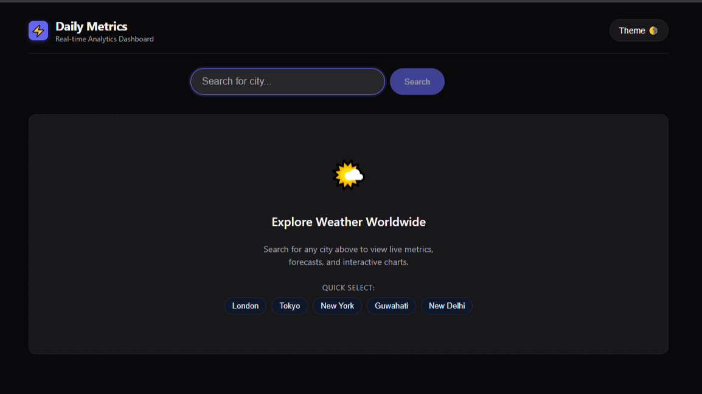
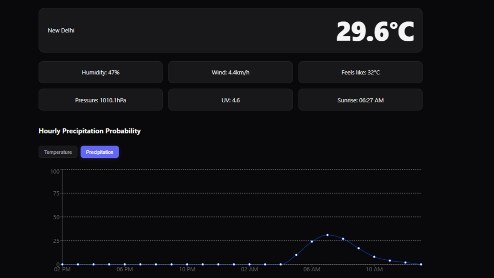
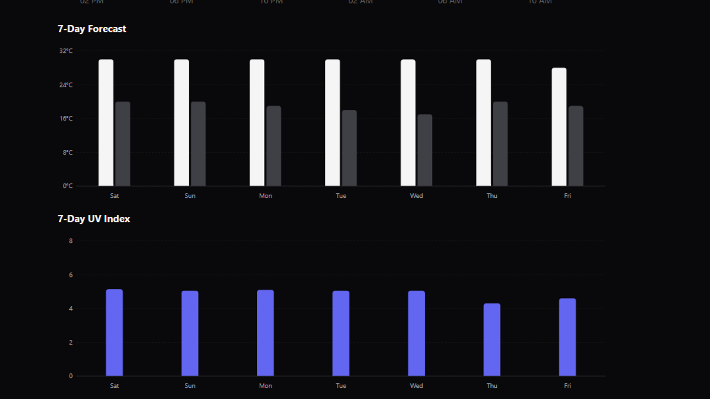
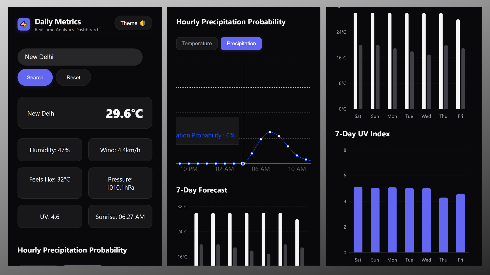

# 🌦️ Weather Analytics Dashboard

A production-grade, highly responsive weather forecasting and analytics web application that delivers real-time meteorological data with a polished, developer-focused user experience. It emphasizes first-principles architecture, strict type safety, and clean data visualization.

---

### Live link

[Check it out](https://zustand-react-weather-dashboard.vercel.app/)

## 📸 Screenshots





#### Mobile view

## 

## 🛠️ Tech Stack

| Category                | Technology                                                                                 |
| ----------------------- | ------------------------------------------------------------------------------------------ |
| **Core Framework**      | React with Vite and TypeScript                                                             |
| **State Management**    | Zustand, using a discriminated union state machine (`idle`, `loading`, `success`, `error`) |
| **Data Visualization**  | Recharts with custom tooltips, active states, and mobile-optimized scrolling containers    |
| **Weather Data Source** | [Open-Meteo](https://open-meteo.com/) REST API (free, open-source)                         |
| **Styling**             | Vanilla CSS modules with custom CSS variables and a dark-slate color palette               |

---

## 🏗️ Key Architectural Highlights & Technical Decisions

### Data Normalization & Transformation

Open-Meteo APIs return forecast data as **parallel arrays** (e.g., separate arrays for timestamps, temperatures, and precipitation probabilities). To make this compatible with modern charting libraries, the application transforms the raw hourly and daily API payloads into clean, unified arrays of objects.

Each data point bundles:

- Time
- Temperature
- Precipitation probability
- Daily min and max metrics

This lets Recharts ingest and render the time-series data seamlessly, without layout bugs or missing bindings.

### Robust State Machine Architecture

Instead of relying on scattered boolean flags (like `isLoading` or `hasError`), the application uses a strict TypeScript **discriminated union** for the fetch status. This:

- Guarantees type safety across state transitions
- Ensures rendering logic handles the idle welcome view, loading state, successful data payloads, and error messages cleanly and predictably

### Mobile-First Data Visualization & Scrolling

Rendering 24 data points on a mobile screen presents severe width constraints. The application solves this with a hybrid responsive layout:

- **Desktop:** Charts scale fluidly to fill 100% of the container width, with no unnecessary scrollbars.
- **Mobile:** The chart container becomes an overflow-scrollable wrapper with a locked minimum width and `touch-action` panning optimizations. Users can swipe across hourly forecasts naturally without triggering whole-window scroll glitches.

### Immersive Idle & Welcome UX

To avoid an empty UI on initial load or reset, the application includes a dedicated idle welcome view with:

- Floating iconography
- Interactive quick-select city chips (**London**, **Tokyo**, **New York**, **Guwahati**, **New Delhi**)

Users can try the app instantly with a single click and search.

---

## 🚀 Getting Started / Local Installation

### Prerequisites

Make sure you have [Node.js](https://nodejs.org/) and npm installed on your machine.

### Installation

1. **Clone the repository**

   ```bash
   git clone https://github.com/CodeCrusher123/zustand-react-weather-dashboard.git
   ```

2. **Navigate into the project directory**

   ```bash
   cd weather-dashboard
   ```

3. **Install dependencies**

   ```bash
   npm install
   ```

4. **Run the development server**

   ```bash
   npm run dev
   ```

5. **Build for production**

   ```bash
   npm run build
   ```

---

### API

Weather Data provided by:

Open-Meteo:
[https://open-meteo.com/](https://open-meteo.com/)

### Author

Nilakesh Barman
